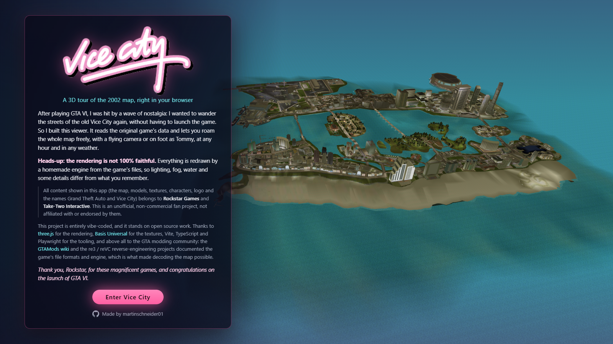

<p align="center">
  
</p>

<h3 align="center">A 3D tour of the 2002 Vice City map, right in your browser</h3>

<p align="center"><b><a href="https://vicecity-3dtour.martin-schneider01.workers.dev">▶ Try it online</a></b></p>



## Why

After playing GTA VI, I was hit by a wave of nostalgia: I wanted to wander the streets of the old Vice City again, without having to launch the game. So I built this viewer.

It reads the original game files (PC, version 1.0) and renders the whole map with Three.js: every building, the beaches, the water and 14 interiors. You can fly around freely or walk as Tommy, at any hour and in any weather, with the game's own lighting and fog. The rendering is not 100% faithful: everything is redrawn by a homemade engine, so lighting, fog, water and some details differ from what you remember.

## Running it

You need Node.js 20+ and your own copy of the game, in `./originalgame/` (or set `VC_GAME_DIR`). The game folder is only read, never modified.

```sh
npm install
npm run build:assets   # converts the game data (about a minute)
npm run intro-image    # optional: renders the intro page background
npm run dev            # http://localhost:5173
```

Controls: WASD (or ZQSD on AZERTY) to move, the mouse to look, **V** to switch between free camera and on foot, **M** for the map, **F** to enter a building, **H** to cycle the HUD.

## Built with

- [three.js](https://threejs.org) for the rendering, and its Basis transcoder
- [Basis Universal](https://github.com/BinomialLLC/basis_universal) for the texture compression
- Vite, TypeScript, tsx and Playwright for the tooling

The whole project is vibe-coded. The nerdy details (formats, what was verified against the data, performance, known limitations) are in [docs/TECHNICAL.md](docs/TECHNICAL.md).

## Thanks

To the GTA modding community, without which decoding the map would not have been possible: the [GTAMods wiki](https://gtamods.com/wiki) for the file formats, and the re3 / reVC reverse-engineering projects for how the engine actually uses them.

And thank you, Rockstar, for these magnificent games, and congratulations on the launch of GTA VI.

## Contributing

PRs are welcome! Just know that this is a side project: I don't plan to maintain it much, so reviews may take a while.

## License and rights

The code is released under the [MIT license](LICENSE). It covers the code only.

Grand Theft Auto, Vice City and all the game content shown by the app (map, models, textures, characters, logo) belong to Rockstar Games and Take-Two Interactive. This is an unofficial, non-commercial fan project, not affiliated with or endorsed by them. The repository contains no game data files; the converted assets stay on your machine.
