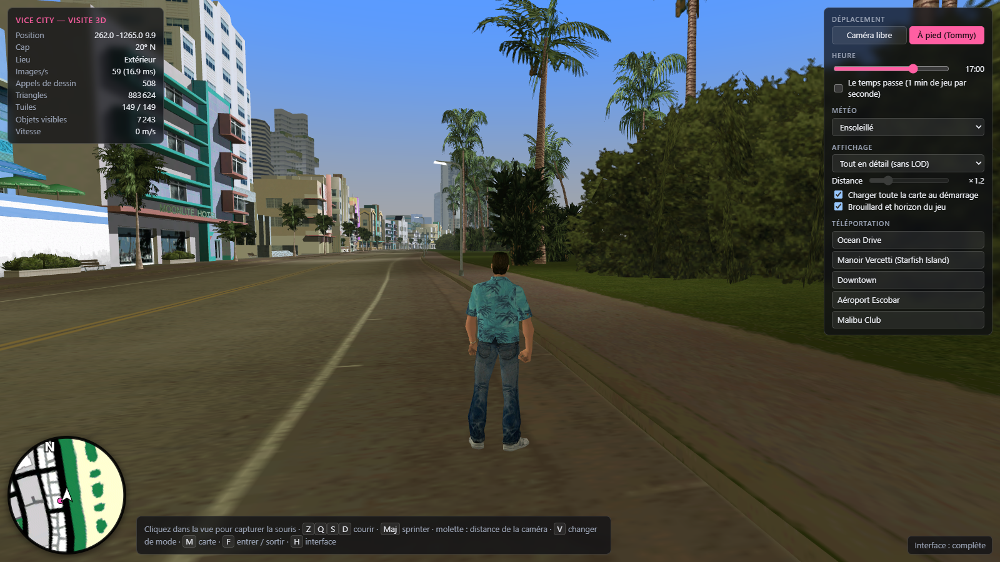
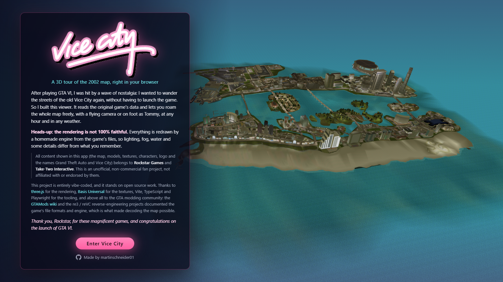

# Vice City 3D tour — technical notes

A local web app for exploring the full map of *GTA: Vice City* (PC, version 1.0 from 2002), rendered with Three.js from the original game files: with a free camera, or on foot as Tommy Vercetti, interiors included.



## Running

Requirements: Node.js 20 or newer, and a Vice City install in `./originalgame/` (the folder containing `data/` and `models/` can be at that level or in a `GTAVC/` subfolder). For an install located elsewhere, set the `VC_GAME_DIR` environment variable.

```sh
npm install
npm run build:assets   # converts the game data (~1 min the first time, ~15 s afterwards)
npm run intro-image    # optional: renders the intro page's poster
npm run dev            # opens the tour at http://localhost:5173
```

The game folder is never modified: the conversion opens it read-only. It writes to a temporary folder, swapped with `public/assets/` at the end (53 MB, ignored by git), and updates `docs/build-report.txt`. Encoded textures are kept in `.cache/basis/`, which makes later conversions fast.

## Intro page



The app opens on an intro page: the game's Vice City logo (exported by `build:assets` to `public/assets/logo.png`, with a text title as fallback), why the project exists, a note that the rendering is not 100% faithful, the rights notice for Rockstar Games and Take-Two Interactive, and a link to [my GitHub](https://github.com/martinschneider01). `?intro=0` skips it; the capture, benchmark and test scripts add it automatically.

Behind the text, the whole map seen from the sky:

1. **Poster.** `public/intro-2560.jpg`, or `public/intro.jpg` (5120 x 2160) on high-density screens, shows up first. It is rendered by the viewer itself (`npm run intro-image`, after `build:assets`; ignored by git like the assets) from the same camera, with the same settings as the live view: LOD pack only, water animation frozen, no fog. It is wider than any screen and fitted to the window height, as the 3D camera is (fixed vertical field of view), so both match pixel for pixel whatever the window shape (measured: no offset, mean difference 1.5/255). It is decoded and painted once, nearly transparent, before it fades in: its first paint is a long frame that would otherwise freeze the fade. The viewer starts loading only once the fade is over.
2. **Live 3D.** The viewer loads only the LOD pack (about 4.5 MB: `far.bin` and its textures) and cross-fades from the poster to the real 3D view, which then starts orbiting the island, easing in. 30 frames per second at most behind the page.
3. **Enter Vice City.** The button turns into a progress bar while the tiles seen from the arrival point on Ocean Drive are loaded, nearest first: everything up to the fog, since full detail mode draws every model that far (103 of the 149 tiles at noon). Their textures are uploaded and every shader compiled behind the loader, the orbit going on. Then the page fades out and the camera flies down in 4.5 s, the game's fog rolling in gradually; nothing else loads during the flight, which stays at 60 frames per second (measured on the RTX 3070: no frame above 16.8 ms). The view on landing is pixel-identical to the fully loaded one; the remaining tiles, all behind the fog, stream in during the next second or so.

Without the poster, the page shows a CSS sunset until the 3D view is ready. With "reduce motion" set in the system, the orbit and the flight are skipped.

## Moving around

Two modes, chosen in the right-hand panel or with the **V** key.

| | Free camera | On foot (Tommy) |
| --- | --- | --- |
| Forward, back, left, right | W A S D | W A S D: he runs, in the camera's direction |
| Up / down | E (or Space) / Q | — |
| Go faster | Shift (×4) | Shift: sprint |
| Mouse wheel | camera speed | camera distance |
| Mouse | look | orbit the camera around Tommy |

Movement keys are *physical key positions*: on an AZERTY keyboard they are Z Q S D, with A / E to go down and up. The help line at the bottom of the screen shows the actual keys. Clicking in the view captures the mouse; Esc releases it.

Other keys: **M** opens the map, **F** enters (or leaves) a building, **H** cycles the HUD display.

On foot, Tommy follows the ground, climbs steps and stairs, slides along walls and wades through water up to his waist. He does not jump.

## Interface

- **Top left**: position in the game's coordinate system (X east, Y north, Z up), heading, location, frames per second, draw calls and triangles (`renderer.info`), loaded tiles, visible objects.
- **Top right**: movement mode, time of day (slider, or automatic flow at 1 game minute per second), weather, display settings, teleports to Ocean Drive, the Vercetti mansion, Downtown, Escobar airport and the Malibu Club.
- **Bottom left**: the minimap, built from the game's radar, centred on you and rotated to match your view. A click (or M) enlarges it: clicking a spot on the large map teleports there, clicking a pink marker enters the building.

Two small buttons, bottom right: the first (or the H key) cycles through three displays — minimap only (the default), full HUD, nothing — and the choice is remembered between visits; the second toggles fullscreen. With the HUD hidden, they reappear when hovering over the corner.

### Display settings

- **Full detail (no LODs)**, the default: every detailed model on the map is drawn at all times. Nothing pops in or changes as you move, at the cost of rendering five times heavier than the other mode (see Performance).
- **Like the game (distant LODs)**: each object appears at the draw distance from the IDE files, multiplied by the "Distance" slider; beyond that, its simplified model (LOD) is drawn instead.
- **Load the whole map at startup** (checked by default): all 149 tiles are loaded up front, in a few seconds, and kept in memory, so you never see blocks arriving late. Unchecked, tiles are loaded around the camera and released as you move away.
- **Game's fog and horizon**: see "Fog fidelity".

### Interiors

Fourteen interiors can be visited: Ocean View Hotel, Vercetti mansion, bank, North Point Mall, Pole Position, Café Robina, shooting range, Ocean Heights apartment, police station, Malibu Club, print works, and the three stadium arenas (Dirtring, Bloodring, Hotring).

Within 100 m of an entrance, the game's marker appears: a translucent pink cylinder topped by an arrow. To enter: click the marker, press F nearby, walk into it as Tommy, or click its pink dot on the large map. To leave: the "Exit" button, F, or the marker placed at the arrival point.

As in the game, once inside you only see the interior and the "visible everywhere" objects; the rest of the city is hidden.

### URL parameters

`pos=x,y,z`, `yaw`, `pitch`, `tp=<place>`, `mode=foot`, `interior=<id>`, `time=13.5`, `weather=0..6`, `detail=auto`, `preload=0`, `dist=1.2`, `fog=0`, `map=1`, `hud=map|all|none`, `rawmouse=0`, `intro=0`. Diagnostics: `view=top` (orthographic top view, with `center=x,y` and `span=metres`), `lod=hd|lod`, `water=0`, `bg=ff00ff`. Example: `http://localhost:5173/?interior=malibu&mode=foot&time=22`.

## Other scripts

| Command | Purpose |
| --- | --- |
| `npm test` | 21 tests: DXT decoding, IDE/IPL parsing, LOD linking, consistency of the converted assets |
| `npm run test:controls` | end-to-end checks in a real browser: mouse, keyboard, both modes, map, entering and leaving an interior, HUD display |
| `npm run screenshots` | retakes the reference screenshots in `docs/screenshots/` |
| `npm run intro-image` | renders the intro page poster (`public/intro.jpg`) and a 4K aerial view of the island (`public/aerial.jpg`) |
| `npm run bench` | measures draw calls, triangles and frame time over a series of views |
| `npm run typecheck` | TypeScript check |
| `npm run build` then `npm run preview` | compiled build in `dist/` (contains the assets: do not publish) |

The scripts that drive a browser use Playwright; the first time, run `npx playwright install chromium`.

Diagnostic tools (run with `npx tsx <file>`): `tools/inspect.ts` (statistics on the game data), `tools/dump-model.ts` and `tools/dump-texture.ts` (contents of a DFF or TXD), `tools/scan-scm.ts` (what the game script hides or replaces, and with `--areas` the interior entrances), `scripts/probe.ts` (evaluates an expression in the viewer, e.g. `vicemap.pick(0, 0)` to find the model at the centre of the screen), `scripts/scan-map.ts` (sweeps the map in top views to look for holes), `scripts/shot-intro.ts` (captures the intro page and checks the whole sequence: live view, nothing detailed loaded before the click, preloading, frame times during the flight).

## Conversion report

The script prints this report and saves it to [`docs/build-report.txt`](build-report.txt), with the full list of what is missing.

| | |
| --- | --- |
| Instances read from the IPLs | 9,114 |
| Instances placed | 9,063: 8,494 outdoors (1,158 in the far pack, 7,336 in 149 tiles) and 569 in 14 interiors |
| Excluded | 51 |
| Models converted | 3,842 (2.0 million vertices, 1.5 million triangles) |
| Models missing or unreadable | 0 |
| Unique textures | 5,136 (4,872 duplicates merged) |
| Texture dictionaries missing | 0 |
| Textures missing | 75 |
| Size | 53 MB: 24 MB of geometry (gzip), 30 MB of textures (132 KTX2 files) |

The 51 exclusions:

- **36 cutscene set instances** (areas 6, 8 and 9: lawyer's office, concert hall, studio). These are partial sets, with no continuous floor and no entrance in free roam.
- **12 exact duplicates**: the same instance written twice in an IPL.
- **2 whole-island LODs** (`IslandLODmainland`, `IslandLODbeach`). The game only shows them from the other island, in place of the individual LODs that the viewer keeps displayed.
- **1 instance in area -1** (`club_exterior07`), which the game never displays.

Other gaps:

- **75 missing textures.** They are referenced by a model but absent from its dictionary, mostly on Little Haiti LODs. The game does not look elsewhere; the viewer draws these faces untextured (vertex colour only). This game behaviour is inferred from how the game is known to work; it has not been verified against the executable.
- **489 scales other than 1 ignored.** Vice City reads the IPL scale field but does not apply it.

## What was verified against the data

The initial assumptions were checked against the real files. Where reality differs from intuition:

- **Quaternions.** The game builds the rotation with the opposite angle (`-2·acos(w)`), which amounts to conjugating the quaternion. Validated by comparison: [without conjugation](screenshots/validation-rotation-raw.png) buildings overlap the streets, [with it](screenshots/validation-rotation-conjugated.png) everything lines up. The unconjugated variant can be reproduced with `VC_RAW_QUATERNIONS=1 npm run build:assets`.
- **LOD / detailed model link.** A model whose draw distance exceeds 300 is a "big building". Its detailed model is another model *from the same IDE file* whose name is identical from the 4th character on (`LODbigshops1` ↔ `od_bigshops1`): 1,097 LODs are linked this way. The rule misses 13 models named `LOD…` which, left alone, would stay drawn over the detailed models: 4 are linked to a model placed at the same spot with a longer name (`LODlleyground5` ↔ `odalleyground5_dy`), 9 (clumps of trees, ramps) fade out within 150 m when surrounded by detailed objects. When several models share the same suffix, we keep the one with an instance closest to the LOD (the game takes the first, which paired `lodbackbit` with a model 340 m away). Two road LODs (`LODoceanrdN1_dy`, `_nt`) inherit the hours of their day/night model; otherwise they overlap in the distance. 58 large objects remain without a detailed model and are always shown: seabeds, tower lights, the blimp, the lighthouse beam.
- **Areas.** The third field of an instance is an area code. The game shows only one area at a time, plus area 13, "visible everywhere" (61 instances, mostly roads and ground around enterable shops). The rule "interior ≠ 0 = exclude" is therefore almost right for the outdoors: area 13 must be kept. Most interiors are built in their real place, behind their door; the stadium arenas float 250 m up.
- **Interior entrances.** They are not in the map files but in the game script: each entrance checks for the player around a point and then calls `SET_AREA_VISIBLE`. The coordinates in `tools/lib/interiors.ts` come from a sweep of `main.scm` (`npx tsx tools/scan-scm.ts --areas`).
- **Lighting.** Vertex colours are deliberately very dark on many models (average 22/255 for an Ocean Drive road). The game *adds* the ambient light from `timecyc.dat` (`Amb` column): `colour = texture × min(prelit + ambient × material, 1)`. IDE flag 32 ("no lighting", 643 models: neon signs, night windows, beams) removes this ambient; forgetting it made the lighthouse beam blinding.
- **Transparency.** As in the game, a transparent surface writes depth, except for models marked with flag 64 (decals, shadows). Without this, a wall whose texture has translucent windows let whatever was behind it show in front of it.
- **DFF frames.** The game ignores the frame transform of each model. Only the `_L0` level is converted.
- **`generic` dictionary.** It corresponds to `models/generic.txd` (loaded at game startup), supplemented by the one in `gta3.img`.
- **Game script.** The commands that hide or replace buildings only appear in missions, not at startup: the IPLs do describe the city's initial state.
- **Water.** The `waterpro.dat` grid is offset 400 units to the west; there is a single water level (z = 6). The radar, for its part, covers -2000 to 2000 on both axes.
- **Character.** Tommy's model lies flat in its reference frame; the animations stand him up. The root of the run animation moves 4.28 m per 0.67 s cycle: that is where his speed comes from (6.4 m/s).

### Fog fidelity

The values are the game's: for each hour and each weather, `timecyc.dat` gives the fog start distance and the far plane, and the viewer interpolates between two hours as the game does. In sunny weather at noon, fog starts at 10 m and becomes total at 2,000 m, which does give Vice City its permanent haze.

Three differences:

- **The colour** is computed with the engine's known formula, (sky top + 2 × sky bottom) / 3. It comes from the documentation of the community-reconstructed game code, not from verification against the executable.
- **The distance** is measured from the point to the camera; the game uses depth along the view axis. At the edges of the screen, the viewer's fog is therefore slightly denser.
- **The far plane** clips objects at the same place as the game, but the game never lets the camera rise to 300 m: from up there, the hazy horizon is more visible than it ever is while playing. The "Game's fog and horizon" checkbox removes it.

## Architecture

```
tools/        conversion (Node, TypeScript)
  build-assets.ts   entry point
  lib/              IMG, IDE/IPL, RenderWare (DFF/TXD), IFP, textures, models, LOD, tiles,
                    character, interiors, water, timecyc
shared/       asset format and DXT codec, shared by the conversion and the viewer
src/          viewer (Vite, TypeScript, Three.js)
  main.ts           loop, modes, teleports
  world.ts tile.ts  loaded packs, visibility, raycasts
  textures.ts materials.ts environment.ts   textures, shaders, sky and water
  controls.ts player.ts                     input, character and follow camera
  minimap.ts interiors.ts ui.ts             map, markers, HUD
scripts/      screenshots, measurements and end-to-end tests (Playwright)
tests/        unit tests and consistency checks
public/assets/  converted assets (generated, ignored by git)
```

### Architecture choices

The architecture suggested at the outset was "one `.glb` per model, PNG or KTX2 textures, a manifest and tiles". The tiling and the manifest are there, but the model and texture formats are different, for performance reasons: a Vice City model has 5 to 6 materials on average, and a conventional renderer (one draw call per material per object) would exceed 5,000 calls per frame.

- **Texture arrays.** Textures are grouped by size and GPU format into 11 classes; the viewer turns each class into an array of compressed textures (BC1 or BC3). The layer index is carried by the vertices, so all materials of the same class are drawn together.
- **Lossy recompressed textures.** On disk, textures are encoded with Basis Universal (ETC1S, KTX2 files, mipmaps included) using the `basisu` encoder from the `basis_universal` npm package: 30 MB instead of 98 MB for the original DXT blocks. Each class is split into files of a few layers (16 textures of 256 pixels, 64 of 128...), because ETC1S shares one block palette per file and degrades if too many different textures share it. At load time, workers transcode each file to BC1/BC3 with the transcoder shipped with three.js (WebAssembly); in video memory the textures still take 98 MB. Quality (192 out of 255) is set with `VC_TEXTURE_QUALITY`; 255 gives about 35 MB, 128 about 20 MB. Without the S3TC extension, textures are transcoded to RGBA (six times more video memory).
- **Compressed geometry.** Geometry files are gzip-compressed (75 MB → 24 MB) and decompressed by the browser on read.
- **Packs: 250 m tiles, far pack, interiors.** A pack is a self-contained binary file: geometry, instances, list of required textures. Each pack becomes one `BatchedMesh` per texture class and render mode; a `BatchedMesh` stores each model's geometry once and draws all its instances, with per-instance visibility. This is instancing of repeated models (607 copies of the same palm tree, 283 posts...). The 1,158 objects with a draw distance above 300 (the LODs) form the far pack; each interior has its own.
- **Visibility.** Every frame, for each instance: visible if the distance to the camera is below its draw distance (× the setting, 1.2 by default); a LOD fades out below its detailed model's distance, once that model's tile is displayed; a `tobj` object only exists between its two hours. Far-pack objects are not culled by distance: the game does it, but its camera never rises high enough to see the city vanish in patches.
- **Transparency.** Each texture is classified at conversion time from its pixels: opaque, cutout (foliage, fences, cables: transparent *and* opaque areas) or translucent (glass, shadows, halos). Cutout uses MSAA *alpha to coverage*, with no sorting. Translucent surfaces are sorted per instance. Seabeds are drawn before the water surface, which writes depth.
- **Collisions.** No `.col` files: the character casts rays against the displayed geometry (one down for the ground, three horizontal for walls, one for the camera). Each pack first tests the bounding sphere of its instances, then the triangles of only the instances hit.
- **Character.** `player.dff` (skin, 24 bones) and four animations from `anim/ped.ifp` are converted into `player.bin`; the viewer makes a Three.js `SkinnedMesh` from it, lit by the "objects" ambient and the directional light from `timecyc.dat`.
- **Coordinate system.** The viewer works directly in the game's coordinate system, Z up. The displayed coordinates are the game's.
- **Custom RenderWare reader.** The `rw-parser-ng` library is not used. The reader in `tools/lib/rw.ts` exposes what the conversion needs and general-purpose libraries expose poorly: vertex colour alpha, geometry flags, ambient coefficient, raw DXT blocks, skin and bone hierarchy.

## Verification

Screenshots in [`docs/screenshots/`](screenshots/), taken by `npm run screenshots` in headless Chromium.

| | Noon | Midnight |
| --- | --- | --- |
| Whole map, detailed models | `top-view-detail-noon.png` | `top-view-detail-midnight.png` |
| Whole map, LODs only | `top-view-lod-noon.png` | `top-view-lod-midnight.png` |
| Ocean Drive | `ocean-drive-noon.png` | `ocean-drive-midnight.png` |
| Vercetti mansion | `mansion-noon.png` | `mansion-midnight.png` |
| Downtown | `downtown-noon.png` | `downtown-midnight.png` |
| Escobar airport | `airport-noon.png` | `airport-midnight.png` |
| Malibu Club | `malibu-noon.png` | `malibu-midnight.png` |

And for the modes: `on-foot-ocean-drive.png`, `on-foot-malibu-night.png`, `interior-malibu.png`, `interior-bank.png`, `interior-mall.png`, `interior-stadium-dirtring.png`, `altitude-like-the-game.png`, `altitude-full-detail.png`, `lighthouse-night.png`, `large-map.png`, plus `interface.png` and `interior-malibu-hud.png` (taken by the end-to-end test) and the two rotation validation screenshots.

The two top views are diagnostic views: they force a level of detail, without fog, to show the whole map at once.

Every screenshot was reviewed. Defects found and fixed along the way:

- nearly black streets (lighting model), blinding lighthouse beam ("no lighting" flag);
- fog-coloured water in large straight-edged patches (fog computed at the vertices of rectangles several kilometres wide);
- seabeds drawn over the water; faces seen through walls with translucent windows;
- buildings stuck as LODs up close: a truncated texture read made a tile fail permanently (reads are now retried), and 13 LODs were linked to nothing;
- city vanishing in patches when seen from altitude (LODs culled at their distance);
- camera suddenly spinning (aberrant mouse movements under pointer lock, now filtered);
- mipmap encoder flattening red-green gradients (found by the unit tests).

The code and screenshots were also reviewed by a second agent that had not seen the work. Its remarks were addressed: gaps seen from altitude and overlapping LODs (above), the conversion writing directly into `public/assets` (now a temporary folder), scripts that did not report incomplete loading, an undocumented roof hole, the LOD logic moved into a tested module, diagonal speed, unbounded URL parameters, and the lack of a message when the graphics card is not supported.

## Performance

Measurements from `npm run bench`: Chromium 1920×1080, Ryzen 7 3700X, GeForce RTX 3070 (a desktop machine, faster than a laptop), whole map loaded. Frame time is measured by chaining 300 renders without waiting for the display. A "draw call" is a batch (`BatchedMesh`); each batch draws several objects, which the browser unrolls one by one under Direct3D.

| View | Batches drawn | Triangles | ms per frame |
| --- | ---: | ---: | ---: |
| Ocean Drive | 35 | 101,957 | 1.8 |
| Vercetti mansion | 34 | 115,638 | 2.0 |
| Downtown | 29 | 94,441 | 2.0 |
| Escobar airport | 42 | 107,138 | 1.9 |
| Malibu Club | 41 | 100,475 | 1.9 |
| Little Haiti at dusk | 41 | 118,920 | 1.9 |
| Prawn Island at night (most batches) | 51 | 114,104 | 1.9 |
| On foot outside the Malibu | 43 | 101,821 | 1.7 |
| Inside the mall | 20 | 72,127 | 0.9 |
| **Ocean Drive, full detail** | 508 | 884,405 | 10.1 |
| **Ocean Beach from the sky, full detail** | 522 | 994,471 | 11.8 |
| Whole map from above (diagnostic) | 1,165 | 1,741,743 | 23.5 |

The default setting is "full detail": 10 to 12 ms per frame on this machine (85 to 100 frames per second). In "like the game" mode, a frame costs about 2 ms, an eightfold margin over the 16.7 ms of a 60 fps display; the actual rate of the full loop (rendering, visibility, collisions, minimap) exceeds 550 frames per second on this machine. In fast flight (3 km at 120 m/s), the average frame takes 1.5 ms and the 99th percentile 4.2 ms; 6 frames out of 16,000 exceed 16.7 ms.

The cost of "full detail" mode comes from the number of batches and objects to unroll, not from triangles; on a laptop, expect fewer than 60 frames per second in the widest views.

Loading the whole map takes a few seconds on this machine (the LODs are there from the start). The measurements in this table predate the texture recompression; it does not change the cost of a frame, only loading (transcoding in workers).

None of this has been measured on a laptop.

## Known limitations

- **Missing roofs.** The Little Havana bank has no roof in the exterior data, nor does the `nbhotel02` tower in Vice Point, and many LODs have roof holes (the reviewer counted about 80; the largest is the big hotel in Washington Beach). Seen from above, a dark backdrop placed beneath the land shows through instead.
- **Lossy recompressed textures**: the difference from the original textures is invisible in the compared views, but it has not been measured texture by texture. The mipmaps are the encoder's; distant fences and foliage may look a little thinner than before.
- **"Full detail" mode**, the default, is five times more expensive than the game's mode. Possible fix: pre-merge the geometry of each tile's unique objects, for a single draw per batch.
- **Teleporting via the map**: you land on the highest surface, so sometimes on a roof. In free camera you arrive 20 m above.
- **Tommy** does not jump, swim or get into vehicles (there are none). Collisions use the displayed geometry, not the game's collision volumes: he can get stuck on a bush or pass an obstacle the game would block.
- **Interiors**: only one entry point per interior (the mall has seven in the game). The three stadium arenas are only accessible during missions in the game; their markers are placed in front of the stadium entrance.
- **Objects created by the game script** (gates, bridge barriers, pickups, parked vehicles): they are not in the IPLs, so they are absent.
- **No fade-in** when objects appear, whereas the game fades them over 20 m.
- **Internal levels of detail** (`_L1`, `_L2` of 19 small objects) are not used.
- **Transparency sorting** is per instance within a batch; between batches, the order is that of the tiles.
- **Back faces** are always drawn, so as not to depend on any assumption about triangle winding.
- **Sky** reduced to the gradient and sun from `timecyc.dat`: no clouds, stars or moon. No street-lamp halos (2dfx effects), no rain.
- **Mouse**: raw movement by default (without OS acceleration), which could not be tested automatically; `?rawmouse=0` reverts to the classic mode.

## Next steps

1. Per-tile merged geometry for "full detail" mode.
2. The game's collision volumes (`.col`), jumping, vehicles.
3. Per-instance fade-in, `2dfx` halos and lights, stars, clouds.
4. The other entrances to the mall and the mansion; the cutscene sets.
5. Measurements on a laptop with an integrated GPU.

## Credits

This project is entirely vibe-coded. It stands on open source work: [three.js](https://threejs.org) for the rendering (and its Basis transcoder), [Basis Universal](https://github.com/BinomialLLC/basis_universal) for the texture compression, Vite, TypeScript, tsx and Playwright for the tooling. Above all, decoding the map relied on the GTA modding community: the [GTAMods wiki](https://gtamods.com/wiki) for the RenderWare, IMG, IDE, IPL and timecyc formats, and the re3 / reVC reverse-engineering projects for how the engine actually uses them (fog, LODs, areas).

## License

The source code is released under the [MIT license](../LICENSE). It covers the code only: the game, its data and anything derived from it (converted assets, rendered images, screenshots, logo) belong to Rockstar Games and Take-Two Interactive and are not covered by it. The repository contains no game data files; the screenshots in `docs/screenshots/` are images rendered from the game.

## Rights

Grand Theft Auto, Vice City and all the game content shown by the app (map, models, textures, characters, logo) belong to Rockstar Games and Take-Two Interactive. This is an unofficial, non-commercial fan project, not affiliated with or endorsed by them.

The code in this repository contains no game data. The converted assets (`public/assets/`, `dist/`, and the `.cache/` cache) are derived from copyrighted files: they stay local and are ignored by git. The screenshots in `docs/screenshots/` show images from the game; it is up to you to decide whether they belong in a public repository.
